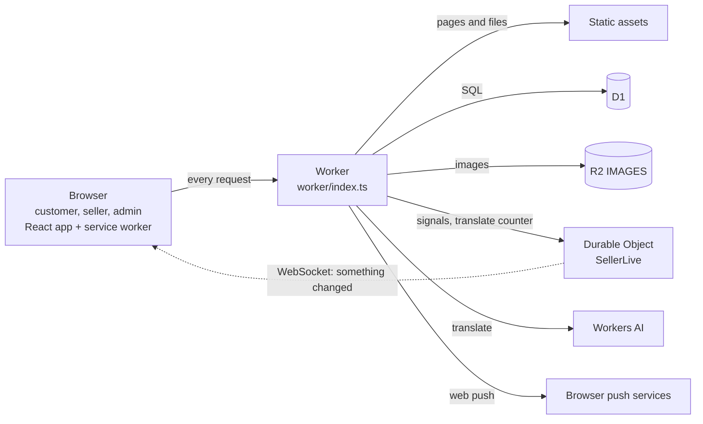

# Architecture overview

Refreshed 2026-10-13. One Cloudflare Worker serves the React app, the kitchen web-app files and the API, at https://order.shaggybobo.app (D-077). State lives in D1 (data), R2 (images) and one Durable Object per kitchen (live events and a daily counter). Routes are listed in [api.md](api.md), tables in [data-model.md](data-model.md), sign-in in [seller-auth.md](seller-auth.md).

## Request path

[`wrangler.jsonc`](../../wrangler.jsonc) sends every path to the Worker except the hashed files in `/assets`, `/samples` and vite's dev modules. The Worker then splits three ways:

| path | what happens | where |
|---|---|---|
| `/api/*`, `/k/*`, `/images/*` | the Worker's own code: `checkOrigin`, health, images, kitchen files, then the API | [`worker/api/index.ts`](../../worker/api/index.ts) |
| any other path | the file or the single-page app from the `ASSETS` binding (conditional headers removed so a phone never keeps a page without its kitchen links), then `withKitchenLinks` | [`worker/index.ts`](../../worker/index.ts), [`worker/pages.ts`](../../worker/pages.ts) |
| the hidden Help path | the page as is, plus `X-Robots-Tag: noindex, nofollow` (D-095) | `worker/pages.ts`, [`shared/help.ts`](../../shared/help.ts) |

**The head rewrite.** For an HTML page, `HTMLRewriter` appends to `<head>`: the kitchen's manifest and icon links, theme colour and link preview for `/<slug>` and `/o/<token>` pages (and sets `data-brand` on `<html>` to the kitchen's theme); the default seller-app manifest for `/seller/*` pages; ShaggyBobo's own preview for anything else. The ETag is dropped and `Cache-Control: no-cache` set, because the head depends on the kitchen. Any error falls back to the default head. Logic: [`worker/api/kitchenPage.ts`](../../worker/api/kitchenPage.ts).

**The API path** (inside `handleWorkerRequest`):

| step | what happens | where |
|---|---|---|
| 1 | `checkOrigin`: a state-changing call to `/api/seller`, `/api/admin` or `/api/auth` must carry the site's own `Origin` (403 `bad_origin`, D-048) | [`worker/auth/origin.ts`](../../worker/auth/origin.ts) |
| 2 | `/api/health` is answered (`/api/status`, the maintenance state, is answered by the router, plan 046); `/images/<key>` streams from R2 | `worker/api/index.ts`, [`worker/images/`](../../worker/images/) |
| 3 | the D1 repository is built from the bindings for this request; nothing is kept between requests. A push dispatcher collects customer messages | [`worker/db/`](../../worker/db/), [`worker/push/`](../../worker/push/) |
| 4 | `/k/<slug>/...` per-kitchen manifests and icons | [`worker/api/kitchenRoutes.ts`](../../worker/api/kitchenRoutes.ts) |
| 5 | the router picks the area (public, token, auth, admin, log, seller, dev), resolves the session cookie, applies the role allowlist, and calls one repository operation per action | [`worker/api/routes.ts`](../../worker/api/routes.ts) |
| 6 | each operation reads in one batched trip and writes in one atomic D1 batch. A portion-limit guard is the first statement of an order write | [`worker/db/`](../../worker/db/) |
| 7 | after a successful write the route nudges the kitchen's Durable Object; push messages are sent after the answer is ready (`waitUntil`), never inside the D1 write | `worker/api/index.ts` |

Business rules live once, in the D1 repository ([D-047](../decisions/README.md)). Tests and the dev server run the same code on a local D1.

## Bindings

| binding | what | notes |
|---|---|---|
| `ASSETS` | the built app | `not_found_handling: single-page-application` |
| `DB` | D1 `shaggybobo-order` | migrations in `migrations/` (0001 to 0016) |
| `IMAGES` | R2 bucket `shaggybobo-images` | objects under `sellers/<id>/...` |
| `SELLER_LIVE` | Durable Object class `SellerLive`, one per kitchen | SQLite-backed (free plan, migration tag `v1`) |
| `AI` | Workers AI, model `@cf/meta/m2m100-1.2b` | the dish-text Translate button (plan 057), 100 a day per kitchen. `remoteBindings: false` in `vite.config.ts`, so **locally there is no AI** and the route answers `translate_unavailable` |
| secrets | `ADMIN_SETUP_KEY`, `VAPID_PUBLIC_KEY`, `VAPID_PRIVATE_KEY`, `VAPID_SUBJECT`, `ADDRESS_KEY` | `.dev.vars` locally, Cloudflare secrets in production. Without VAPID keys push is off. `ADDRESS_KEY` (plan 071, D-099) is base64 of 32 random bytes (`node -e "console.log(require('crypto').randomBytes(32).toString('base64'))"`, then `pnpm exec wrangler secret put ADDRESS_KEY`; keep a copy in Keeper). Without it the menu says no addresses and the checkout hides the field; if it is lost, undelivered addresses read "not available" and customers enter them again |
| variable | `MAPS_EMBED_KEY` | Plan 071: the Google **Maps Embed API** key for the checkout's "Check your address" panel. **Not a secret** (the page shows it; restrict it in Google Cloud to the website and to the Maps Embed API only), so a plain Cloudflare variable (dashboard), `.dev.vars` locally, not in `wrangler.jsonc`. Sent in the public menu answer as `mapsEmbedKey` only when set (and addresses are on). Without it the button opens the Maps app. No Content-Security-Policy is set today; if one is added, allow `frame-src https://www.google.com` |
| `workers_dev` off | one custom domain, `order.shaggybobo.app` | |

## Live updates

[`SellerLive`](../../worker/live/SellerLive.ts) is a WebSocket room per kitchen, using hibernation (an idle room costs nothing; ping and pong are answered without waking it). Seller screens connect to `/api/seller/live` with their session. A write sends one of four small signals (`order.created`, `order.changed`, `menu.changed`, `stock.changed`; [`shared/liveContract.ts`](../../shared/liveContract.ts)), the room broadcasts it, and the screens refetch through the normal API. The signals carry no customer data. A missed signal is covered by slow polling ([`src/api/live.ts`](../../src/api/live.ts)). The same object also keeps the day's translation count.

## Web push

A customer turns notifications on from one order's page; the browser subscription is stored against that order only (no phone number, no person). When a seller's change tells the customer something, the dispatcher sends it after the response. [`public/sw.js`](../../public/sw.js) shows the notification and opens the order on click. A fully paused kitchen sends nothing (D-086).

## Scheduled jobs

`triggers.crons` in `wrangler.jsonc` runs `scheduled` in `worker/index.ts`:

| cron | does | code |
|---|---|---|
| hourly (`0 * * * *`) | finishes every live menu whose cooking day has ended (midnight Melbourne), archives its orders and prunes past-menu pictures beyond the newest 10; sweeps old "find my order" tries | [`worker/api/scheduled.ts`](../../worker/api/scheduled.ts) (`runAutoFinish`, `runAttemptSweep`) |
| Mondays 03:00 UTC (`0 3 * * 1`) | also `runRetention`: drops order details 4 weeks past the cooking date, and day-sales rows older than 10 weeks | `runRetention` |

If the weekly entry changes, change `RETENTION_CRON` in `scheduled.ts` with it. Both are idempotent and log counts only, for example `retention: 2 week(s) archived, 14 order(s) dropped`. Rules in [data-model.md](data-model.md#retention). To try it on a scratch server: `curl -k https://localhost:<port>/cdn-cgi/handler/scheduled`.

## The client

One React + TypeScript app (Vite), Redux Toolkit with redux-saga, with three apps in one bundle ([`src/app/AppRoutes.tsx`](../../src/app/AppRoutes.tsx)):

| app | paths | notes |
|---|---|---|
| customer | `/`, `/:slug`, `/:slug/basket/*`, `/o/:token/*`, `/my-orders`, `/settings` | no account; order tokens live on the phone |
| seller | `/seller/*` (orders, cook, sell, menu, share, hand-over, settings, devices, more...), `/seller/setup`, `/seller/sign-in` | owner, chef and helper; screens depend on the role |
| admin | `/admin/*`, `/admin/setup`, `/admin/sign-in` | desktop-first, English |
| Help | the hidden path in `shared/help.ts` | public, no sign-in, not linked from customer pages |

| topic | how it works | where |
|---|---|---|
| Languages | EN and ID for every visible string, through i18n (`react-i18next`). A kitchen sets `languages` (`both`, `en` or `id`) and an optional first language; customers otherwise see the phone's language | `src/i18n/`, each feature's `i18n/` |
| Service worker | hand-written, scope `/`, registered in production builds only (or `VITE_SW=1`). Network-first with a cache fallback for the app shell (`/`) and for `GET /api/s/:slug/menu` and `/api/orders*`, so a phone without signal shows what it loaded last. **Never cached:** `/version.json`, `/api/seller`, `/api/auth`, `/api/admin`, `/api/dev`, `/api/push`, non-GET calls, and the `/seller` and `/admin` pages. Change `CACHE_VERSION` when the rules change | [`public/sw.js`](../../public/sw.js) |
| New version | the build writes `/version.json` (`Cache-Control: no-store`); the app compares it with its own version every 5 minutes and shows the **UpdateBar** to reload. Not in dev | [`src/components/update/`](../../src/components/update/), `public/_headers` |
| Retry policy | only a `GET` is retried (no answer, 5xx or 429), after about 1, 3 and 9 s with jitter, or the `Retry-After` (max 30 s). A save is never repeated by itself, so nothing is ordered twice; the screen says "Didn't go through". 4xx are final | [`src/api/retryPolicy.ts`](../../src/api/retryPolicy.ts), [`http.ts`](../../src/api/http.ts) |
| Network state | `netState` records every call's final outcome; polls back off (gap doubles to 5 min) and stop after 5 refusals until "Try again"; **OfflineBanner** reads it | [`src/api/netState.ts`](../../src/api/netState.ts), [`src/components/network/`](../../src/components/network/) |
| Device drafts | half-typed forms are kept in `localStorage` per kitchen and form (`draft:v1:...`), for 7 days, and offered back with a notice. All storage calls are in try/catch | [`src/components/draft/`](../../src/components/draft/) |
| Home-screen apps | each kitchen has its own web-app manifest with a fixed `id` (`/<slug>` for customers, `/seller` for the seller app) so installed apps keep their identity; the page links it in the head (server-side first, React after). A home-screen app remembers its own kitchen and does not follow the last one visited (plan 068) | [`shared/kitchenManifest.ts`](../../shared/kitchenManifest.ts), [`src/components/install/`](../../src/components/install/) |
| Error log | devices send short scrubbed error entries to `/api/log`; the admin reads them | [`src/api/clientLog.ts`](../../src/api/clientLog.ts) |

## The dev flag

`DEV_TOOLS=1` (set only in a local `.dev.vars`, never in `wrangler.jsonc` or as a Cloudflare variable) turns on every dev-only path: the `X-Seller` / `X-Actor` headers that stand in for a session, the `?seller=` fallback on the live socket, `/api/dev/*`, sample orders and reset, and the dev seller picker. The app asks `/api/health` whether it is on. Production runs without it: those paths answer as if they did not exist, and the repository itself refuses `dev.reset`.

## Where data lives while developing

| what | where | owner |
|---|---|---|
| The owner's dev data (`pnpm dev`, port 5173) | `.wrangler/state` | the owner; agents never touch it |
| End-to-end tests | `scratch/e2e-d1`, made fresh by `scripts/scratch-server.mjs` (migrated and seeded, port 5181) | each Playwright run |
| Throwaway checks | `scratch/smoke-*` through the same script, on a port of its own | whoever started it |
| Unit and MSW tests | `scratch/d1-tests/<file>-d1`, one local D1 per test file through wrangler's `getPlatformProxy`, deleted afterwards | `mocks/impl.ts` |

The scratch script refuses any directory outside `scratch/` and port 5173. Agents never deploy or run `--remote` commands; the builder does.

## Local and production

| piece | local | production (live since D-077) |
|---|---|---|
| Worker, assets | `@cloudflare/vite-plugin` (Miniflare), HTTPS with mkcert, reachable from phones on the home Wi-Fi | custom domain `order.shaggybobo.app` |
| D1 | local SQLite, `database_id` fallback `local-only` | the real database; migrations applied by the builder |
| R2 (`IMAGES`) | simulated bucket | `shaggybobo-images` |
| Durable Object | local, SQLite-backed | the same migration tag `v1` |
| Workers AI | none (`remoteBindings: false`) | live binding |
| Secrets | `.dev.vars` | Cloudflare secrets; `DEV_TOOLS` never set |
| Cron | triggered by hand | runs on the schedule |
| Passkeys | `https://localhost` only (WebAuthn refuses an IP address); phones on the LAN use the password | the real domain makes passkeys work on phones |
| Limit to design for | none locally | free plan: 50 D1 queries per invocation (held under 40 by a test) |

Before a release, read the latest `docs/plans/release-*.md` checklist.
