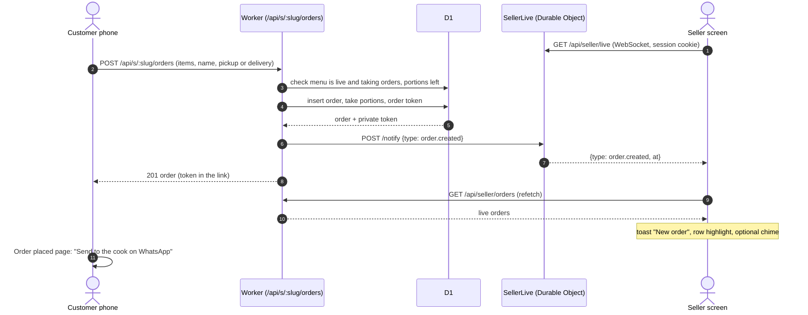
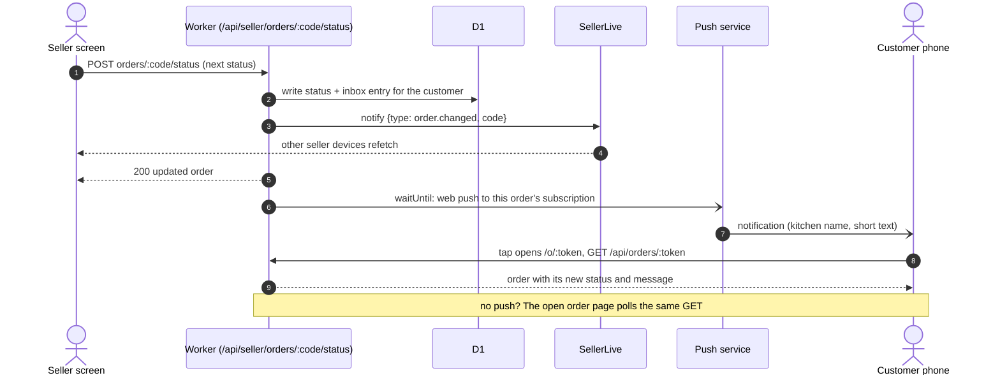
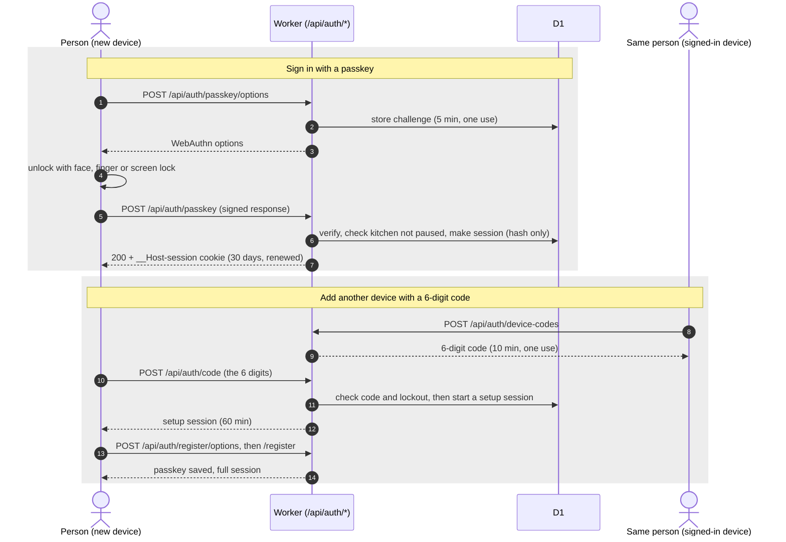
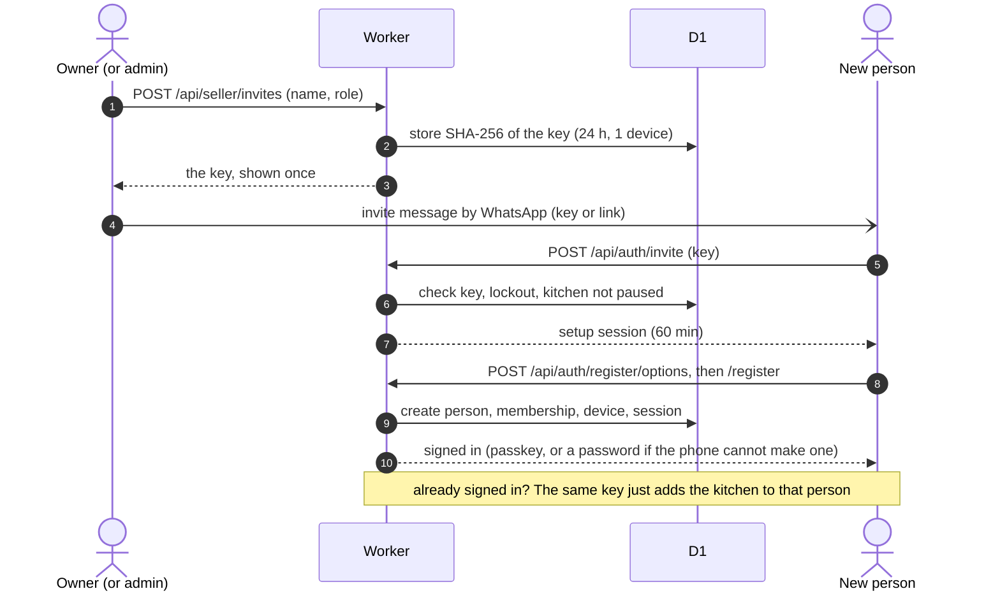
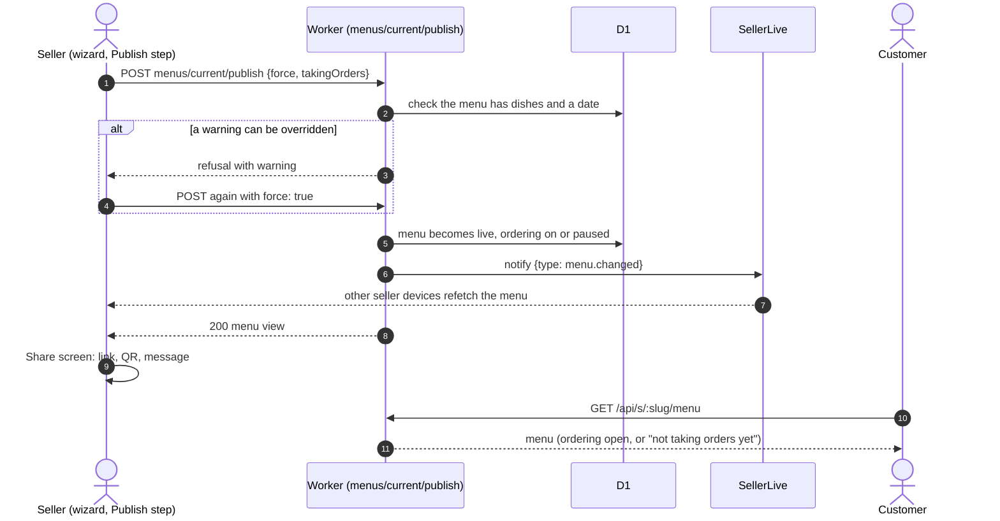
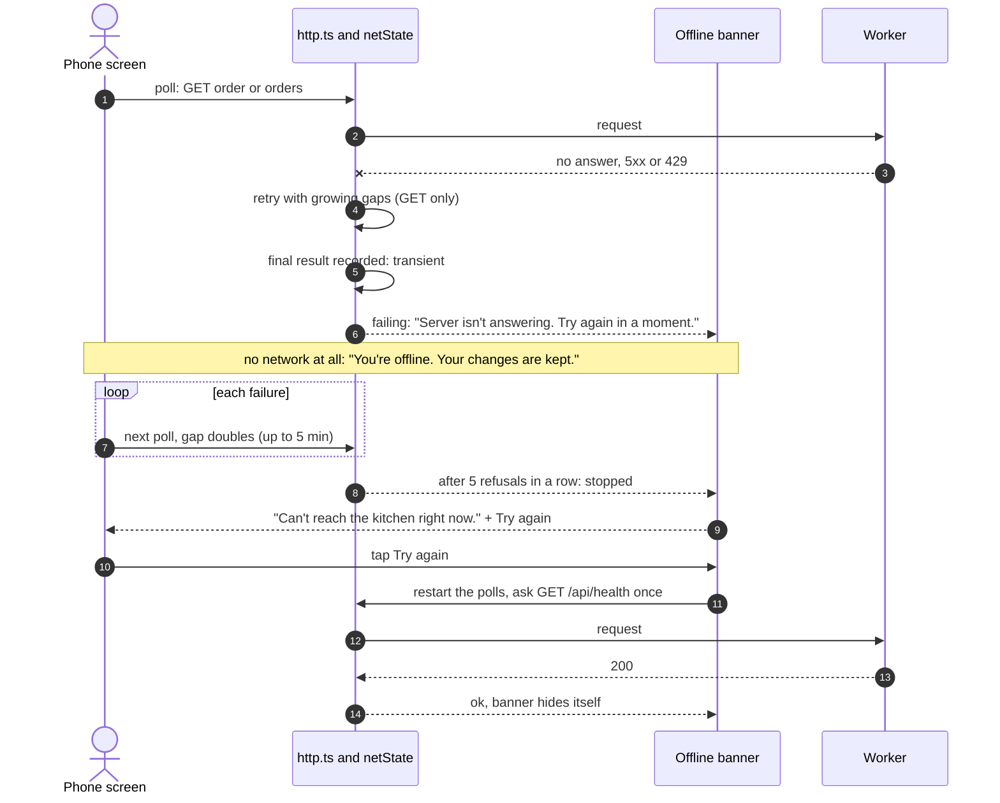
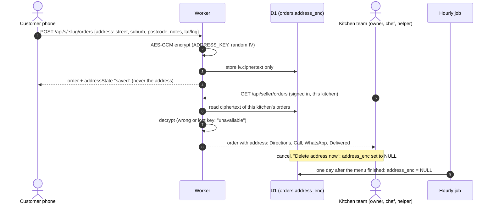
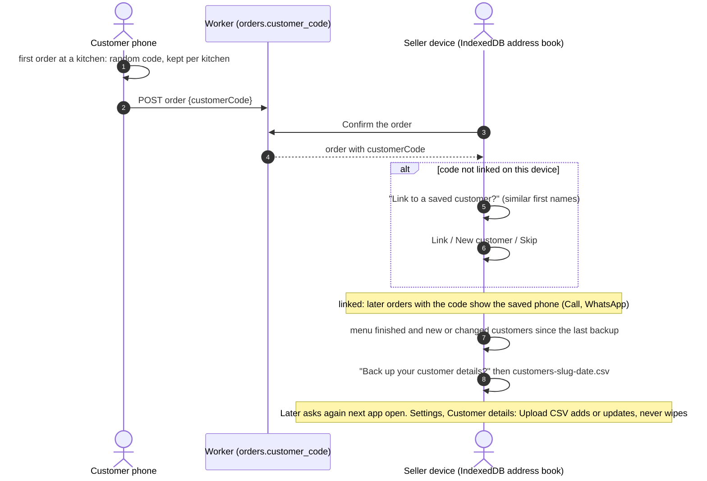
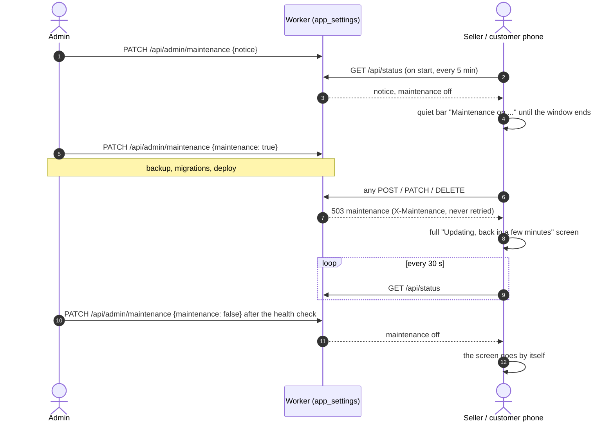
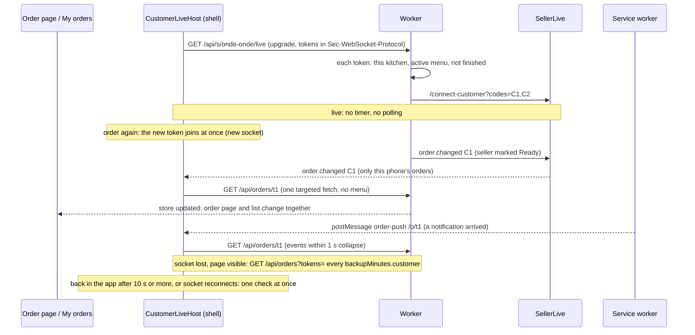

# Message sequences

Written 2026-10-13 (plan 070) from `worker/api/routes.ts`, `worker/api/authRoutes.ts`, `worker/live/`, `worker/push/`, `src/api/http.ts` and `src/api/netState.ts`. The diagrams are Mermaid: GitHub draws them, and `pnpm run docs` draws them in the HTML site. When a route, a live event or a sign-in rule changes, change the diagram in the same change (CLAUDE.md, "Docs stay current"). Routes are listed in [api.md](api.md); the system around them in [overview.md](overview.md); sign-in rules in [seller-auth.md](seller-auth.md).

Two facts hold in every diagram:

- The **live event is only a nudge** ("something changed", with an order code at most). It carries no customer data; the seller's screen refetches through the normal, authorised API.
- The Worker **signals after the D1 write succeeded** and never fails the answer because of it. A missed nudge is covered by the screens' fallback polling.

## 1 · A customer places an order

The seller is told by the **open app** (live socket, toast, optional chime). There is no web push to the seller yet ([plan 021](../plans/021-seller-new-order-alert.md): "seller push when the app is closed is a later, separate plan"). The customer then sends the order number to the seller on WhatsApp by hand; the app only opens WhatsApp with the text written.



## 2 · The seller changes a status

Only the **customer's** subscription gets a web push (one per order, if the customer turned it on). The push is built after the write and sent in `waitUntil`, so the seller's answer is not slowed. An open customer app also hears the change over its own live connection (section 11), and a push arriving while the app is open makes the service worker tell the page, which refreshes that order at once.



## 3 · Seller sign-in with a passkey (and the 6-digit add-device code)

Passkey sign-in works from anywhere. A **new device** is added by a signed-in person: Settings, Devices makes a 6-digit code (10 minutes, one use, stored as a hash) that the new device enters.



Five wrong tries lock the key or person for 15 minutes (`locked_out`); sign-in calls are limited to 30 a minute per browser id.

## 4 · Invite, then setup with the key

The owner invites a person by name and role (the admin invites a kitchen's first owner; a recovery is the same call). The key is shown once and is good for 24 hours and one device.



## 5 · Publish a menu (now, or with ordering paused)

A menu goes `not published -> live -> finished` (D-063). Publishing can ask for **ordering paused**: the menu is visible, but the customer cannot place orders until the seller turns ordering on. Customers read the menu from the same route, so the new state shows on their next load.



## 6 · Offline, retry, "Can't reach the kitchen"

Only **GET** calls are retried on their own (no answer, a 5xx or a 429, with growing gaps). Writes such as placing an order are not repeated for the person: the screen shows the error and the customer can try again. The banner has three messages: offline, server not answering, and **"Can't reach the kitchen right now." with Try again**, shown when a poll gave up after 5 refusals in a row.



## 7 · A delivery address: customer, encrypted store, kitchen team, auto-delete

Plan 071, [D-099](../decisions/README.md). Only on delivery orders, and only when the server has `ADDRESS_KEY`.



## 8 · Linking a customer and backing up the device address book

Plan 071, [D-099](../decisions/README.md). The address book (names, phones, addresses, codes) lives only in the seller's device (IndexedDB); the server only ever sees the anonymous `customerCode`.



## 9 · Announce an update and run it in maintenance mode

Plan 046. The admin announces, switches maintenance on before the backup and migrations, and off after the health check.



## 10 · Seller screens on the live connection and the backup check (plan 074)

Orders, Cook, Sell and Hand over / Delivery run share one WebSocket per tab. They ask for nothing while it is live; an event names what changed, and each screen reloads only that.

```mermaid
sequenceDiagram
    participant A as Admin page
    participant W as Worker
    participant S as Seller screen (Sell)
    participant DO as SellerLive
    A->>W: PATCH /api/admin/backup-minutes {seller: 5}
    S->>W: GET /api/status (MaintenanceHost, every 5 min)
    W-->>S: backupMinutes {customer: 5, seller: 5}
    S->>W: first load (menu, day log, orders)
    Note over S,DO: socket live: no timer, no polling
    S->>W: POST /api/seller/day/sale
    W-->>S: dayStock, entryId (the screen updates itself)
    W->>DO: stock.changed (from = X-Device-Id)
    DO-->>S: stock.changed (from = this device: echo ignored)
    DO-->>S: stock.changed (another device's sale, different or no `from`)
    S->>W: GET /api/seller/menu (stock only)
    Note over S,DO: socket lost and page visible: one check every backup minutes
    S->>W: reload everything
    Note over S: page hidden: nothing; page shown again: reload at once
```

## 11 · The customer app's one live connection, backup check and notification refresh (plan 074)

The customer shell mounts `CustomerLiveHost` once ([liveConnection.ts](../../src/features/customer-orders/liveConnection.ts)). It opens **one WebSocket per kitchen** where this phone has an active order (not collected, delivered or cancelled; not from a closed week; placed in the last 10 days; normally one). The order page and My orders never open sockets or poll: they read the store, which the connection keeps fresh.

Authorisation is the private order tokens only: `GET /api/s/:slug/live` with the tokens in the `Sec-WebSocket-Protocol` header as `delave.live, tok.a, tok.b` (up to 20, WebSocket upgrade; plan 098 C12 - the old `?tokens=a,b` form is still accepted for tabs opened before the update). The Worker checks every token belongs to **that** kitchen, is on its active menu and is not finished, and hands the room only the **codes** of the orders it admitted. The room (`SellerLive`, `/connect-customer`, tagged `customer`, hibernating) sends such a socket only `order.changed` for those codes (a change without a code, such as "Ready now" or finishing the week, is a bare nudge to every customer socket of that kitchen; no data in it). Seller sockets are untouched: kitchen-wide events never reach a customer. At most 300 customer sockets per kitchen.



Backup rules: only while a kitchen's socket is down and the page is visible; the gap is `backupMinutes.customer` from `GET /api/status` (5 when absent), through [orderPoll.ts](../../src/features/customer-orders/orderPoll.ts) so plan 062's rules hold (backoff after failures, stop after 5 refusals until Try again, pause while hidden). Finished orders are dropped from the connection when their status reaches the phone, and with none left the socket closes and nothing is checked. Settings shows one muted line from [customerLiveState.ts](../../src/api/customerLiveState.ts): "Connection: live", "Last updated 10:42 · checking every 5 min", or "No active orders".
