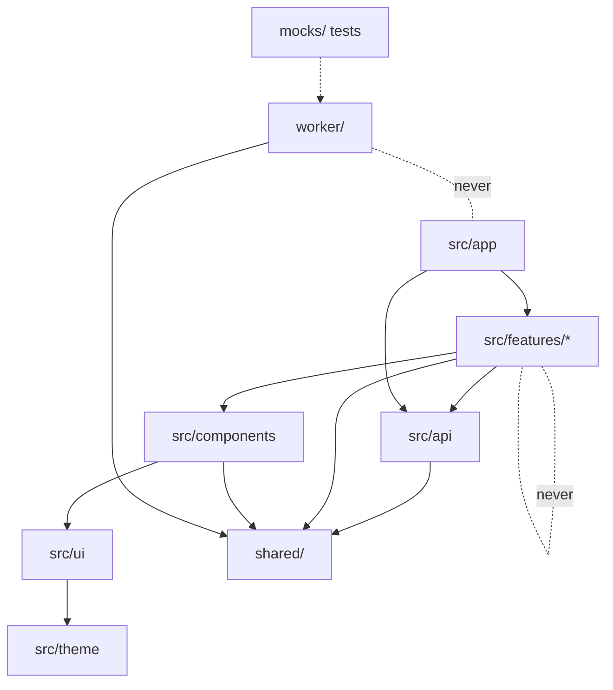

# How the source is kept

Written 2026-10-13 from the repo itself: `eslint.config.js`, `tsconfig*.json`, `package.json`, `playwright.config.ts`, `vite.config.ts`, `vitest.config.ts` and the folders. One package; the React app and the Worker are built by the same Vite project ([D-003](../decisions/README.md)). This replaces the older "Proposed folder structure" in [the roadmap](../plan/roadmap.md#proposed-folder-structure), which still shows `worker/routes/` and a smaller feature list; the roadmap section is history.

## 1. Top-level folders

| folder | what lives there |
|---|---|
| `src/app` | the shell (customer addresses: `customerRoutes.tsx`, `customerPath.ts`; seller app per kitchen: `LaunchGate.tsx`, `launchKitchen.ts`, `SellerMoveNotice.tsx`): routes (`AppRoutes.tsx`), store and root saga, session, guards, seller rail and layout, sign-in frame, kitchen switcher. The only place that wires features together |
| `src/features/*` | one folder per screen group; each owns its screens, state and API use. Today: `admin`, `chef-income`, `customer-menu`, `customer-orders`, `customer-settings`, `seller-auth`, `seller-cook`, `seller-help`, `seller-history`, `seller-home`, `seller-labels`, `seller-menu`, `seller-orders` (and more; `ls src/features`) |
| `src/components` | pieces shared by customer and seller screens that know about the app: draft notice, install and push flow, network banner, update bar, language and theme switches, QR and scan, labels |
| `src/ui` | the generic kit (button, field, list row, pill, dialog, menu, icons). Knows nothing about orders |
| `src/theme` | design tokens (colour, spacing, type, radius), the five kitchen themes, light and dark, global styles. The only place literal values live |
| `src/api` | typed API client; the only code that calls `fetch` (`http.ts`), plus retry policy, network state, live socket, client log, device storage helpers |
| `src/i18n` | i18next setup and the shared `en.json` / `id.json`; each feature adds its own bundle |
| `src/harness` | dev-only pages (`?harness=<name>`), dropped from production builds |
| `shared/` | contracts (`*Contract.ts`), types, limits, dates and pure helpers used by **both** the app and the Worker. No React, no Worker APIs |
| `worker/` | the Cloudflare Worker: `index.ts` (fetch and cron entry), `pages.ts` (head rewrite), `redirects.ts` (old `/o/<token>` to the kitchen path), `api/` (routes), `db/` (D1 code), `repo/` (the Repository interface), `live/` (Durable Object), `images/` (R2), `auth/`, `push/` |
| `migrations/` | D1 SQL migrations, numbered `0001_...sql` |
| `mocks/` | MSW setup and the unit tests that run the real Worker code on a local D1 (`impl.ts`, `server.ts`, `*.test.ts`) |
| `e2e/` | Playwright specs and their helpers |
| `public/` | static files: service worker, manifests, icons, help pictures, `_headers`, sample pictures |
| `scripts/` | local tooling: `scratch-server.mjs`, `seed-local.mjs`, design captures, icon and VAPID key makers |
| `uxDesign/` | design references from the owner (`seller/`, `customer/`) |
| `docs/` | the project's docs ([README](../README.md)); `briefs/` holds the concept brief |
| `temp/`, `scratch/`, `captures/`, `backups/` | **git-ignored**: owner-dropped assets, test databases and logs, screenshots, D1 exports (real data) |

Also at the top: `wrangler.jsonc`, `vite.config.ts`, `vitest.config.ts`, `playwright.config.ts`, `eslint.config.js`, the four `tsconfig*.json`, `index.html`, `CLAUDE.md`.

## 2. Layering rules

Enforced by `import-x/no-restricted-paths` and `import-x/no-cycle` in `eslint.config.js` ([D-003](../decisions/README.md)).

| importer | may import | may not import |
|---|---|---|
| `src/app` | features, components, ui, theme, api, i18n, shared | `worker/`, harness |
| `src/features/X` | components, ui, theme, api, i18n, shared, **itself** | app, **any other feature**, `worker/` |
| `src/components` | ui, theme, api, shared | features, app |
| `src/ui` | theme, shared | components, features, app |
| `src/theme`, `src/i18n`, `src/api` | shared and each other where needed | app, features |
| `src/harness` | app-side code | app and worker; and only `src/main.tsx` may import a harness |
| `shared/` | itself | `src/`, `worker/` |
| `worker/` | `shared/` | `src/` |
| `mocks/`, `e2e/` | anything (test code; `mocks/` also runs the Worker code) | |

Two things the rules mean in practice: when two features need the same thing it moves **down** into `components`, `api` or `shared`, never sideways; and a rule that both the app and the Worker care about (a limit, a status, a contract parser) lives once in `shared/`.

## 3. Conventions

| topic | rule |
|---|---|
| Feature folder | screens (`*Screen.tsx`), `*Slice.ts` and `*Saga.ts` where there is state, `*Model.ts` for pure logic, `index.ts` as the only public door, `i18n/en.json` + `i18n/id.json`, and tests **next to the code** (`*.test.ts(x)`) |
| Strings | every visible string through i18n in EN and ID; each feature exports a `registerXxxI18n()` |
| Styling | theme tokens only (D-006): a lint rule rejects literal colours and px values inside styled-components templates (`src/theme` is exempt) |
| Exports | named exports only (`no-default-export`); default exports allowed for tool configs and `worker/index.ts` |
| Types | strict TypeScript, no `any`, generic array type `Array<T>` |
| Contracts | request and response types plus their parsers live in `shared/*Contract.ts` (`orderContract`, `menusContract`, `authContract`, `chefSummaryContract`...); `shared/apiError.ts` holds every error code. The client and the Worker both parse with them |
| Rules once | business rules live in the D1 repository only ([D-047](../decisions/README.md)) |
| Tests | Vitest for `src`, `shared` and `mocks` (jsdom, a local D1 behind the API); Playwright for flows |

## 4. Checklists

**Add a feature**
1. Plan in `docs/plans/` and owner approval (D-055); a mock-up before any UI.
2. `src/features/<name>/` with `index.ts`, screens, slice/saga if it has state, `i18n/en.json` + `id.json`, tests beside the code.
3. Contract in `shared/<name>Contract.ts` if it talks to the Worker; client call in `src/api/<name>.ts`.
4. Register the i18n bundle in `src/main.tsx` and the saga/reducer in `src/app` (store, `rootSaga.ts`).
5. The new folder is picked up by the "no other feature" lint rule automatically (it reads `src/features/`).
6. Add a harness in `src/harness/` only if screens need a stand-alone page.

**Add a route**
1. UI route: `<Route>` in `src/app/AppRoutes.tsx`; if it needs a guard, `guards.tsx`; seller navigation in `sellerNav.ts`.
2. API route: contract in `shared/`, a branch in `worker/api/routes.ts` (and the role allowlist `chefMayNot` / `helperMay` if a chef or helper is involved), the operation on `worker/repo/Repository.ts` and its D1 code in `worker/db/`.
3. If it must be live to other devices, send a signal (`order.changed`, `menu.changed`...).
4. If it must not be cached offline, check `NEVER_CACHE_*` in `public/sw.js`.
5. Update [api.md](api.md) in the same change.

**Add a migration**
1. Next number in `migrations/` (`0017_<what>.sql`), add-only where possible; a changed CHECK means rebuilding the table (see 0007, 0010).
2. Keep each `CREATE TRIGGER ... END;` whole (the migrate script splits on statements).
3. Update `shared/` types and the repository; add a test in `mocks/`.
4. Update [data-model.md](data-model.md) in the same change, plus the deploy note: the builder applies it (agents never run `--remote`).

## 5. If we restructure later

Things that make a move harder than it looks:

| coupling | where | what breaks |
|---|---|---|
| Path-based layer rules | `layerZones` in `eslint.config.js` use literal paths (`./src/ui`, `./src/features`, `./worker`) | a renamed folder silently loses its rule until the zone is edited |
| Feature names read from disk | `featureNames` in `eslint.config.js` | safe for adding; a rename needs nothing but the imports |
| tsconfig projects | `tsconfig.app.json` includes `src`, `shared`, `mocks`; `tsconfig.worker.json` includes `worker`, `shared`; `tsconfig.node.json` includes configs and `e2e`; `tsconfig.json` references the three | a new top-level folder is not type-checked until it is added to one |
| Vitest include | `vitest.config.ts`: `src/**`, `shared/**`, `mocks/**` | tests outside these globs never run |
| Playwright projects | `playwright.config.ts` matches specs by **file name** (`testMatch` / `testIgnore`) in 15 named projects | renaming or splitting a spec silently moves it into another project or none |
| i18n registration | `registerXxxI18n()` calls in `src/main.tsx` (one per feature or component bundle) | a moved feature whose bundle is not registered shows raw keys |
| Harness loading | `import.meta.glob('./harness/*.tsx')` in `src/main.tsx` | file name must equal the `?harness=` name |
| Worker entry paths | `wrangler.jsonc` `main: worker/index.ts`, `migrations_dir`, `assets`; `worker/index.ts` `RETENTION_CRON` | moving these needs a deploy-time check |
| Worker files copied from `src` | `shared/kitchenManifest.ts` copies theme colours because the Worker cannot import `src/` | a token change must be made twice |
| Static paths | `public/sw.js` regexes, `public/_headers`, `shared/help.ts` (hidden Help path), `/k/<slug>/` URLs | installed apps and caches hold the old URLs |
| Scripts and docs | `scripts/scratch-server.mjs` refuses paths outside `scratch/`; docs link to files by path | links rot |

**A safe order** (each step ends with `pnpm typecheck`; the full gate once at the end, by the owner's rule):
1. Move **leaf** code first: pure helpers into `shared/` or `src/api`, with their tests.
2. Move one feature at a time. Rename the folder, fix imports, update its `registerXxxI18n()` import in `src/main.tsx`, and check any Playwright spec matched by name.
3. Update `eslint.config.js` zones and the tsconfig `include` lists **in the same step** as a folder move, then run `pnpm lint` to prove the rules still fire (add one forbidden import on purpose and confirm the error).
4. Move `worker/` internals only with `wrangler.jsonc` and `mocks/impl.ts` open: both name paths.
5. Do not move `migrations/` files or rename a migration after it has been applied anywhere (wrangler tracks them by name).
6. Last: docs links, then this page and [overview.md](overview.md).
