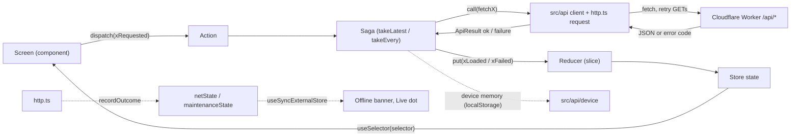
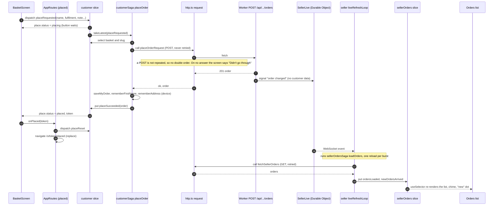
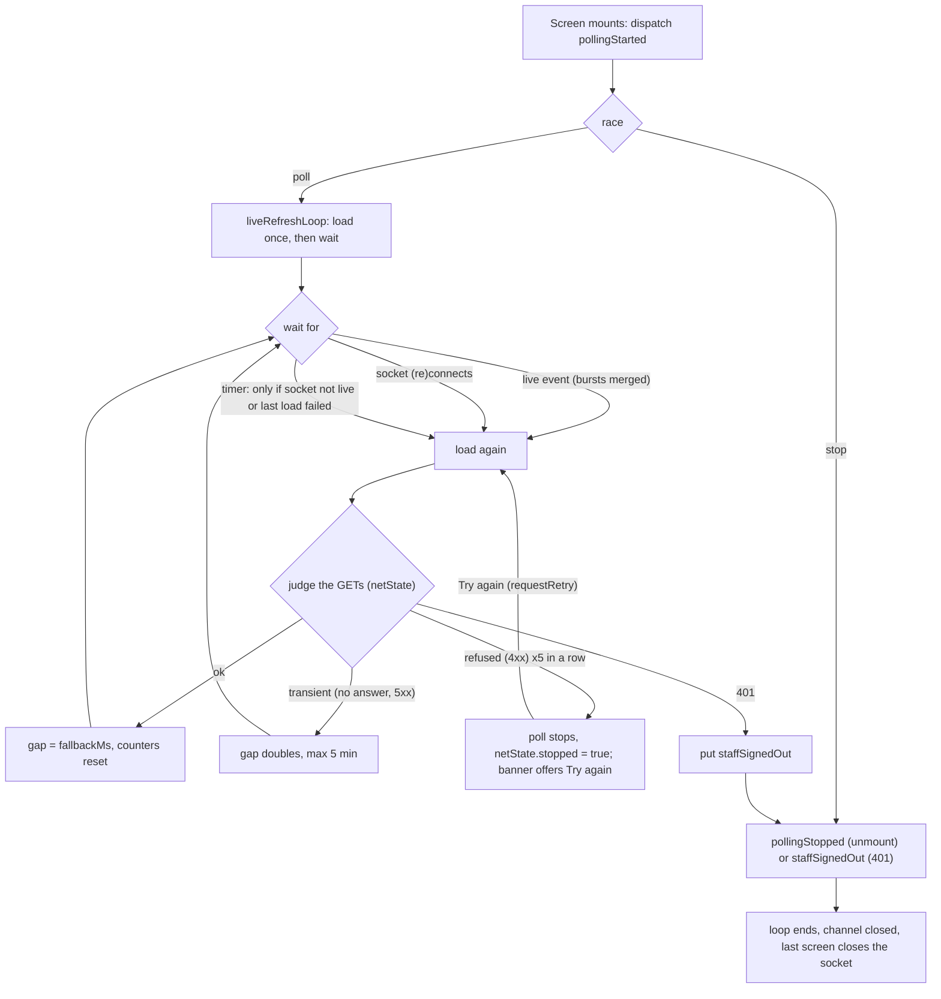
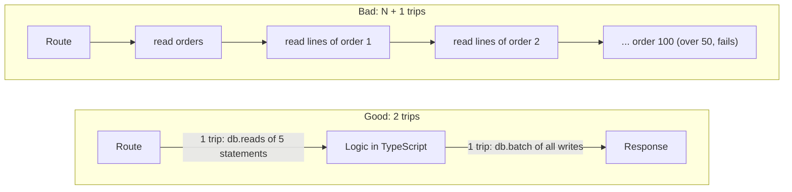

# State and data flow

How the browser app keeps its state: what lives in React context, a Redux slice, a saga, a component, or the device. Written from the code as of plan 070; file links are the source of truth, this page is the map.

The short version: **the server is the truth.** Screens never call the API. A screen dispatches an action, a saga calls `src/api`, the answer goes into a slice, and the screen reads it back through a selector. Everything that is not server data (who is signed in, the colour theme, a half-typed form) lives somewhere smaller.

## 1. Which tool for which state

| State is... | Put it in | Real example |
|---|---|---|
| Server data that several screens show, or that changes under the screen (orders, the menu, settings) | **Redux slice**, loaded by a **saga** | `sellerOrders.orders` ([sellerOrdersSlice.ts](../../src/features/seller-orders/sellerOrdersSlice.ts)) |
| A request in flight and its outcome (`loading`, `error`, `busy`, a toast) | The same slice, as a small state machine (`status: 'idle' \| 'placing' \| 'placed' \| 'failed'`) | `customer.place` ([customerSlice.ts](../../src/features/customer-menu/customerSlice.ts)) |
| Anything that needs an API call, a timer, a retry, a socket or several steps in order | **Saga** (the only code that talks to `src/api` for a slice) | [saga.ts](../../src/features/customer-menu/saga.ts) `placeOrder` |
| Something every screen below a point needs to *read*, that rarely changes and is not server data to cache (who I am, a role flag, the real address behind a layer) | **React context**, provided once near the top | `SessionContext` in [session.tsx](../../src/app/session.tsx) |
| A dumb flag derived from the session, to hide buttons | Context, set by the shell | `ReadOnlyOrdersContext` ([orderAccess.tsx](../../src/features/seller-orders/orderAccess.tsx)) |
| Filter, search, tab, step | **The URL** (router) | the orders list filter is `?status=&q=`, not in the slice (see the comment in `SellerOrdersState`) |
| Open or closed, hover, the text being typed in one field | **Component state** (`useState`) | any dialog or popover |
| Form text that must survive a reload or a closed slide-over | **Device storage** through a hook | `useDraft` ([useDraft.ts](../../src/components/draft/useDraft.ts)) |
| Things this phone remembers between visits (my orders, last kitchen, first name, address, theme, language) | **Device storage** (`localStorage`/IndexedDB) in [src/api/device/](../../src/api/device) or a small store beside the feature | `saveMyOrder` in [myOrders.ts](../../src/api/device/myOrders.ts) |
| Cross-cutting runtime facts that are not screen data (network up or down, maintenance on, live socket status) | A **tiny module store** with `watch...` functions, read by `useSyncExternalStore` | [netState.ts](../../src/api/netState.ts), [maintenanceState.ts](../../src/api/maintenanceState.ts) |

Rules of thumb:

- If two screens need it, or it must survive navigating away and back, it is a slice. If one screen owns it, it is component state.
- If it needs `fetch`, it is a saga. A component never imports from `src/api` for slice data. (A few small reads still do, see section 8.)
- Context is for *who and what mode*, not for lists of server data. Context re-renders every reader on change; a slice with selectors does not.
- Never keep the same server fact in two places on purpose. Section 8 lists where that happened anyway.
- Secrets never go to device storage. The session is an HttpOnly cookie; scripts cannot read it ([seller-auth.md](seller-auth.md)).

## 2. The store

[src/app/store.ts](../../src/app/store.ts) combines eight reducers with `configureStore` (thunk off, saga middleware on) and runs [rootSaga.ts](../../src/app/rootSaga.ts), which starts one saga per slice with `all([call(...)])`. `createAppStore()` is a function, so a test or a harness gets its own store. The `<Provider>` and `AppThemeProvider` are mounted in [main.tsx](../../src/main.tsx) and [App.tsx](../../src/app/App.tsx).

## 3. Every Redux slice

Eight slices, eight sagas. "Calls" are the `src/api` functions the saga uses (all end in [http.ts](../../src/api/http.ts) `request`).

| Slice (store key) | Feature | Holds | Saga watchers | API calls |
|---|---|---|---|---|
| `customer` | [customer-menu](../../src/features/customer-menu) | the open kitchen's menu, the basket (`itemId` to qty), checkout fields, basket-change notices, and four request states: `place`, `order`, `edit`, `update` | `customerSaga`: `takeLatest` on menu, place, order, edit, update | `fetchMenu`, `placeOrderRequest`, `fetchOrder`, `updateOrder` ([client.ts](../../src/api/client.ts)); also writes device storage (`saveMyOrder`, `rememberKitchen`, `rememberFirstName`, `rememberAddress`) |
| `customerOrders` | [customer-orders](../../src/features/customer-orders) | the "My orders" list, the order page, a menu cache per kitchen (`menus`), `cancel` and `collect` states | `customerOrdersSaga`: `takeLatest` list, order, refresh, collect; `takeEvery` menu, cancel | `fetchMyOrders`, `fetchOrderOrExpired`, `fetchMenu`, `cancelOrder`, `markCollected` ([customer.ts](../../src/api/customer.ts)); `rememberStatus` to device |
| `sellerOrders` | [seller-orders](../../src/features/seller-orders) | the order list, current and past menu, the status/paid/lock change state, warnings the seller can override, undo toasts, "fresh" and "unseen new" counters, the link prompt, demo/dev flags | `sellerOrdersSaga`: `takeEvery` for each order change, `takeLatest` for loads, `takeLeading` for create and demo; plus `watchPolling` (live loop) | `fetchSellerOrders`, `fetchCurrentMenu`, `fetchPastWeeks`, status/paid/lock/nudge/collected/seen calls, `createOrder`, dish patch ([client.ts](../../src/api/client.ts), [menus.ts](../../src/api/menus.ts), [demo.ts](../../src/api/demo.ts)); plays the chime for new orders |
| `sellerCook` | [seller-cook](../../src/features/seller-cook) | the Cook screen: orders, the menu items and chefs, the "made so far" counts | `cookSaga`: `takeLatest` refresh, plus `watchPolling` | `fetchSellerOrders`, `fetchSellerMenu`, `fetchMade` ([made.ts](../../src/api/made.ts)) |
| `sellerMenu` | [seller-menu](../../src/features/seller-menu) | everything the menu maker edits: current menu, dishes, saved sets, pickup places, chefs, preferences, past weeks; `busy`, `result`, a `seq` counter | `menuSaga`: `takeLatest` load, `takeEvery` `opRequested` (one `MenuOp` union: publish, unpublish, dish create/update/delete, pictures, pickup places, sets...) | [menus.ts](../../src/api/menus.ts) (about 20 calls) plus `fetchChefs`, `fetchCurrentMenu`, `fetchPastWeeks`, `updateItem` |
| `sellerSettings` | [seller-settings](../../src/features/seller-settings) | the kitchen settings, this week's cut-off, a `version` that resets the form, `save` state, a toast | `settingsSaga`: `takeLatest` load, save | `fetchSettings`, `saveSettings`, `fetchSellerMenu` |
| `sellerSetup` | [seller-setup](../../src/features/seller-setup) | kitchen images (logo, banner, style), the chef list with weekly counts, busy and failure per slot, a toast | `setupSaga`: `takeLatest` for images, upload, remove, style, chefs, chef change | image calls and chef create/rename/delete ([client.ts](../../src/api/client.ts), [settings.ts](../../src/api/settings.ts)) |
| `sellerShare` | [seller-share](../../src/features/seller-share) | the share page: menu and settings, `status` | `shareSaga`: `takeLatest` load | `fetchCurrentMenu`, `fetchSettings` |

Admin screens ([features/admin](../../src/features/admin)), seller sign-in ([seller-auth](../../src/features/seller-auth)), history, labels, help and saturday have **no slice**: they call `src/api` from hooks or components with local state (see section 8). That is allowed; a slice is for data that several screens share or that needs a saga's ordering.

Slices follow one shape (look at any of them): a `status`/`load` field, `xRequested` (the saga's trigger, usually with a `prepare` so the payload is typed), `xLoaded`/`xSucceeded`, `xFailed`. A saga never mutates state; it only `put`s these actions.

Selectors live beside the slice (for example [customer-menu/selectors.ts](../../src/features/customer-menu/selectors.ts), `createSelector` for the basket lines). Components use `useSelector` with them, 39 files at the time of writing.

## 4. Every React context

Four contexts we created, and the providers of libraries we use. All of them are provided inside `<Provider store>`.

| Context | Provides | Provided by | Read by |
|---|---|---|---|
| `SessionContext` ([session.tsx](../../src/app/session.tsx)) | `me` (who is signed in, from `GET /api/auth/me`), `refresh`, `adopt`, `end` | `SessionProvider`, wrapping the routes in [AppRoutes.tsx](../../src/app/AppRoutes.tsx) | `useSession()` in the route guards ([guards.tsx](../../src/app/guards.tsx)), [SellerLayout](../../src/app/SellerLayout.tsx), [AuthRoutes](../../src/app/AuthRoutes.tsx), the kitchen and person switchers, and several seller screens |
| `ReadOnlyOrdersContext` ([orderAccess.tsx](../../src/features/seller-orders/orderAccess.tsx)) | one boolean: a helper sees orders read only (plan 028) | `SellerLayout`, value `me?.role === 'helper'` | `useReadOnlyOrders()` in the orders screens, [useOrderActions](../../src/features/seller-orders/useOrderActions.ts), address and dishes panels |
| `AccessContext` / `IncomeAccess` ([chef-income/access.tsx](../../src/components/chef-income/access.tsx)) | `'all'` (owner), `'own'` (a chef while the kitchen allows it) or `null`: who gets "Per chef" / "My income" (plan 069). The provider fetches the preference itself for chefs | `IncomeAccessProvider` in `SellerLayout` | `useIncomeAccess()` in [ChefIncome.tsx](../../src/components/chef-income/ChefIncome.tsx) and the home screens |
| `RealLocation` ([AppRoutes.tsx](../../src/app/AppRoutes.tsx)) | the address as typed, while the screens behind a menu-wizard layer see the background address (plan 037) | `AppRoutes` | `WizardLayerHost` only |
| Library: Redux `Provider` | the store | [main.tsx](../../src/main.tsx) / [App.tsx](../../src/app/App.tsx) | every `useSelector` / `useDispatch` |
| Library: styled-components `ThemeProvider` | the light or dark theme object | `AppThemeProvider` ([src/theme](../../src/theme/AppThemeProvider.tsx)); it follows the device preference and the seller's kitchen brand | every styled component |
| Library: react-i18next | the language, the translation function | `initI18n` in main.tsx; each feature registers its own namespace (`registerCookI18n()` and the like) | `useTranslation('namespace')` |
| Library: react-router | location and navigation | `BrowserRouter` in `App` | `useNavigate`, `useParams` |

Session note: the session is also mirrored into a plain module, [api/device/sellerContext.ts](../../src/api/device/sellerContext.ts) (`setSessionSeller`, `currentSellerSlug()`), which `applyMe` in session.tsx updates. Sagas cannot call hooks, so they read the seller slug from that module instead of from context.

## 5. State kept on purpose outside Redux

| What | Where | Why it is not in Redux |
|---|---|---|
| Form drafts | [components/draft](../../src/components/draft) (`useDraft`, `draftStore.ts`, device storage) | Per field, per key, debounced 400 ms, must survive a reload, and never carries a secret. It has nothing to do with server state until Save. |
| Auto-save of the menu wizard's ticks and price / limit edits (plan 072), and of the Cook "made" counts and Pack ticks (plan 073) | [components/autoSave/autoSave.ts](../../src/components/autoSave/autoSave.ts) (`AutoSaver`, `useAutoSave`; re-exported from seller-menu), shown by `AutoSaveStatus` (shared, takes the i18n namespace). Cook (`useMadeCounts`): the pending value is each tapped dish's start and final count; one `addMade` per changed dish with the difference (the server adds, so other devices' taps stay), what the server already got is not sent again on a retry. Pack (`PackTab`): the pending value is each ticked bag's final ticks; one `packOrder {ticked}` per bag; "Packed" first flushes and waits (`whenIdle`) so the ticks reach the server before `packed`; a refusal puts the bag back. Same 1 s pause, flush on leave / page hide, "Not saved yet · Try again" as below | A change shows at once (the screen reads `pending ?? server value`). One `updateMenu` (or one `updateMenuDish` per changed dish, sent together) follows 1 s after the last change; one save in flight, newer changes go next (latest wins). `flushIfDue` runs when the step closes (effect cleanup), on `pagehide` / `visibilitychange`, and before the wizard's tab, Next/Back, Done and Close (`AutoSaveGate`). The pending value is also a plan 061 device draft (`draftStore`), cleared on success. A refusal (any code except network, bad response, maintenance, sign-in, closed kitchen) undoes the pending value and says why; a failure keeps it and shows "Not saved yet · Try again", retried only on the next change, Try again or the connection returning (plan 062). It is a plain object outside React so a save started when the step closes still finishes. Answers are matched by a `ref` on the op (`useSendOp`). |
| Short read cache (plan 073) | [shortCache.ts](../../src/api/shortCache.ts), [cachedReads.ts](../../src/api/cachedReads.ts) | A 60 s in-memory cache (per page session, per kitchen slug) for small seller reads that several screens repeat: `fetchSettingsCached` (`useSellerLanguages`, FirstTime), `fetchPreferencesCached` (`IncomeAccessProvider`, `ChefIncomeSetting`, `KitchenBrandSync`) and `fetchCurrentMenuCached` (the "not published" badge in `useNotPublished`, 2 min, so changing seller page does not ask again). Only answers that worked are kept; concurrent reads share one request. `saveSettings` and `updatePreferences` clear their keys (even when the save fails), and the menu wizard writes each new menu view into the badge's entry (`noteCurrentMenu`). The Settings forms, the wizard's own load, WhatsApp dialog and share/settings sagas read fresh on purpose (they save what they read). Tests clear it after each test (`mocks/setup.ts`). |
| Customer memory: my orders, last kitchen, first name, address, customer code, "how it works" seen | [src/api/device/](../../src/api/device) and [howItWorksSeen.ts](../../src/features/customer-menu/howItWorksSeen.ts) | The product rule is no accounts and no phone numbers in the cloud: the phone remembers. Sagas write to it after a server success. |
| Seller address book | IndexedDB, [seller-orders/contacts](../../src/features/seller-orders/contacts) (`addressBook.ts`, `bookBackend.ts`) | Private to the device, not sent anywhere (the cloud holds no phone numbers). Read with `useSyncExternalStore`. |
| Order draft for a seller-made order | [useOrderDraft.ts](../../src/features/seller-orders/useOrderDraft.ts) | A draft, same as above. |
| Network state | [netState.ts](../../src/api/netState.ts) | `http.ts` records the *final* result of every call here (after retries). It is read by polls, the live dot and the offline banner. It has no imports, so any module can use it without a cycle. |
| Maintenance flag | [maintenanceState.ts](../../src/api/maintenanceState.ts) | `http.ts` sets it on a 503 `maintenance`; the "Updating" screen reads it and clears it when `/api/status` says the update is over. |
| Live link status (`live`, `reconnecting`, `offline`) | [live.ts](../../src/api/live.ts) `getLiveLink` / `watchLiveLink` | Describes the socket, not data. Read by [LiveDot](../../src/components/LiveDot.tsx). |
| New-orders badge, banner collapsed, media query, theme and text-size preferences | small `useSyncExternalStore` stores: [newOrderBadge.ts](../../src/features/seller-orders/newOrderBadge.ts), [useBannerCollapsed.ts](../../src/components/useBannerCollapsed.ts), [theme/](../../src/theme) | Per-device preferences. |
| Update bar, offline banner, maintenance notice | each `mount...()` in [components/update](../../src/components/update), [network](../../src/components/network), [maintenance](../../src/components/maintenance) creates **its own React root** next to the app (inside its own `AppThemeProvider`) | They must still show when the app itself crashes, is mid-update, or is not loaded, so they cannot depend on the store or the router. They read the module stores above. |
| Install and push flow | [components/install](../../src/components/install) (`useInstallFlow`, `flow.ts`, `installPrompt.ts`, `pushBrowser.ts`) | Browser capability state (service worker, permission, `beforeinstallprompt`), local to the device. |

## 6. Diagrams

### 6.1 The one-way loop

The arrow back is always the same: saga `put`, reducer, selector. A component never gets a promise result from a saga.

### 6.2 One real example: a customer orders, the seller sees it

On failure the saga puts `placeFailed({code, message})`; for `sold_out`, `exceeds_remaining`, `cutoff_passed`, `ordering_closed` or `kitchen_closed` it also dispatches `menuRequested`, so the basket is trimmed and the banner can say what changed (`refreshMenuAfter`).

### 6.3 Live and poll loops, and when they stop (plan 062)

The socket itself ([live.ts](../../src/api/live.ts) `connectLive`) reconnects with backoff 1 s doubling to 30 s with jitter, pings every 25 s (10 s to answer), and **gives up after 8 attempts in a row**; the slow poll carries on. One socket per tab is shared (`subscribeLive`: first subscriber opens, last one closes), so the Orders list and the Cook screen share it. A 401 from any call closes it.

Retry rule for calls ([retryPolicy.ts](../../src/api/retryPolicy.ts)): only a GET that got no answer, a 5xx or a 429 is retried, after about 1 s, 3 s and 9 s plus up to 25 % jitter (a 429's `Retry-After` wins, max 30 s). A maintenance 503 (header `X-Maintenance`) is never retried. A POST, PATCH, PUT or DELETE is never repeated by itself.

Plan 074 changes to the loop: the gap between backup checks is the admin's **seller backup minutes** (default 5; `GET /api/status` -> [backupMinutes.ts](../../src/api/backupMinutes.ts), kept fresh by `MaintenanceHost`), read each time; a **hidden page asks for nothing** and loads at once when it is shown again; and `load(changed)` receives the event types of the burst (`null` = first load, reconnect, backup check, return to front: everything). Orders reloads the menu on `menu.changed` and the orders on `order.*`; Cook reloads orders + made counts on `order.*` (a made tap is signalled as `order.changed`) and the menu on `menu.changed`; `stock.changed` (a day sale) reloads nothing on either. Orders and Cook are not open at the same time, so one event does not fetch the orders twice.

**Sell and Hand over / Delivery run** do not use the saga loop: [useLiveReload.ts](../../src/features/seller-saturday/useLiveReload.ts) is the same rule as a hook (no timer while connected; backup check only while the socket is down and the page visible; reload on reconnect and on return to front; events while hidden wait for the page to be shown). [SellScreen](../../src/features/seller-saturday/SellScreen.tsx) fetches parts: a sale elsewhere (`stock.changed`) reloads the menu (stock) only; the day log and the orders feed only the Summary tab, so on the Sell tab they are marked stale and fetched when Summary opens. A sale, set count or undo **on this device** is applied from the POST answer (`dayStock`) and that device's echo event is ignored by **device id**: each seller tab makes a random id once per session ([deviceId.ts](../../src/api/deviceId.ts)), sends it as `X-Device-Id` on every seller write, the Worker puts it on the live event as `from` (seller sockets only; customer sockets never get it), and a screen skips an event only when `from` is its own id. No time window: another device's sale right after ours still reloads the stock, and an old client without the header counts as someone else's. One sale = one request. [useHandoverData](../../src/features/seller-saturday/parts.tsx) reloads orders + message log on `order.*` and the places on `menu.changed`; after an action on the screen it fetches orders + messages once and ignores its own echo (same device id).

Who starts the loops: `sellerOrders` and `sellerCook` each run `watchPolling` in their saga. The screens dispatch `pollingStarted` in an effect and `pollingStopped` in its cleanup ([ordersShared.tsx](../../src/features/seller-orders/ordersShared.tsx), [CookScreen.tsx](../../src/features/seller-cook/CookScreen.tsx), and the delivery and order-detail screens).

### 6.3b The customer app's live connection (plan 074)

Customers have no polling screens. `CustomerLiveHost` (mounted in `CustomerShell`) runs `startCustomerLive`: it follows this phone's saved orders (`activeOrders()` in [myOrders.ts](../../src/api/device/myOrders.ts); every write to them fires `myorders:changed`, so a new order joins the socket and a finished one leaves at once), opens one socket per kitchen through `connectLive`, and turns events into store actions: `orderLiveRequested(token)` (one fetch, no menu; `orderPatched` updates the open order page **and** the My orders list together) or `listRequested` (the whole list; `listLoaded` also refreshes the open order page). `useUnseenUpdate` loads the list once, not on every navigation, and reads "seen" fresh from the phone. Backup check = `startOrderPoll` at `backupMinutes.customer`, only while a socket is down. Service-worker `order-push` messages call the same `orderLiveRequested`. The Settings line reads the tiny store in [customerLiveState.ts](../../src/api/customerLiveState.ts) (no imports).

### 6.4 After a menu wizard op: use the answer, re-read only the rest (plan 073)

`runOp` in [menuSaga.ts](../../src/features/seller-menu/menuSaga.ts) no longer calls `fetchAll` (7 GETs) after every op. Each op returns an `Outcome` with a `patch` (data taken from the op's own answer, put in the slice with `patched`) and a `reload` list (the parts the answer cannot carry, read with one GET each by `reloadParts`).

| Op | Answer used | Re-read |
|---|---|---|
| updateMenu (the auto-save), publish, unpublish, deleteMenu, picture ops, addDishToMenu, useSet, usePast, createMenu | the new menu view | nothing |
| finish | the new menu view | past weeks |
| createDish | the menu view (when added to the menu) | the library (its order is the server's) |
| updateDish | the dish (replaced in the list) | the menu, only when its copy followed |
| updateMenuDish | (the item only) the library dish when kept in step | the menu (and the library if the dish update failed) |
| deleteDish | nothing | menu, library, sets |
| createSet | nothing | sets |
| place ops | nothing | places and menu |

After a failed op (or a refused add after a created dish) everything the op can change (`PARTS`) is re-read, as before. `fetchAll` (7 GETs) stays for the first load and Retry. The phone preview ([PhonePreview.tsx](../../src/features/seller-menu/PhonePreview.tsx)) reads the seller, kitchen and ordering state once when it opens and builds dishes, date, cut-off, delivery and places from the slice, so a save does not fetch.

## 7. How to add state to a feature

1. **Decide where it lives** with the table in section 1. Most new things are *not* a new slice: URL, component state or a draft often do.
2. **Server data shared by screens:** add fields to the feature's existing slice (or a new `xSlice.ts` if it is a new feature), with a `status`/`load` and a `xRequested` / `xLoaded` / `xFailed` trio. Export the `XRootState` type so selectors and sagas can type `select`.
3. **API call:** add a function in `src/api` that uses `request(path, parse)` with a parser for the contract in `shared/`. Add the route to [api.md](api.md) in the same change.
4. **Saga:** write a generator that `call`s the api function and `put`s the result. `takeLatest` for loads, `takeEvery` for independent changes, `takeLeading` for "ignore a second click". Read the seller with `currentSellerSlug()`.
5. **Register:** export from the feature's `index.ts`; for a new slice add the reducer to `combineReducers` in [store.ts](../../src/app/store.ts) and `call(newSaga)` in [rootSaga.ts](../../src/app/rootSaga.ts).
6. **Selectors** beside the slice; screens use `useSelector` and `useDispatch` only. No `fetch`, no `src/api` import in the component.
7. **Live data:** if the data changes while the seller watches, run it through `liveRefreshLoop` and dispatch `pollingStarted` / `pollingStopped` from the screen. Add the event type in [shared/liveContract.ts](../../shared/liveContract.ts).
8. **Device memory or a draft:** use `src/api/device/*` or `useDraft`; never a secret.
9. **Strings** in EN and ID, in the feature's `i18n` folder.
10. **No circular imports** (a lint rule); the `src/api` layer imports nothing from features. See [source-layout.md](source-layout.md).
11. **Tests** (section 9), then update this page if a slice, context or loop was added.

## 8. Things that look inconsistent

Found while writing this page. None is a bug today; all are places where a change may need to touch two files. They are for the owner to rule on, not changed here.

- **Seller orders are held twice.** `sellerOrders.orders` and `sellerCook.orders` both load `fetchSellerOrders` and each runs its own live loop, so with the Orders list and the Cook screen open the same list is fetched twice per event.
- **The current menu is held in four slices.** `sellerOrders.current`, `sellerMenu.data`, `sellerShare.menu`, and `sellerCook.menu` (a trimmed copy) all come from the current-menu endpoints; `sellerSettings` and `sellerOrders.menu` also call `fetchSellerMenu`. Each screen reloads on entry, so they do not drift visibly, but a live event refreshes only the slices whose loop is running.
- **Customer menu twice.** `customer.menu` (the basket's menu) and `customerOrders.menus` (a per-kitchen cache for the order page) both come from `fetchMenu`. Both slices also define an action called `menuRequested`; they are different slices with their own sagas, but a grep for the name finds both.
- **Session in two places.** `SessionContext` (for components) and `sellerContext.ts` (a module, for sagas and `api`) both hold the signed-in seller; `applyMe` keeps them in step. `staffSignedOut` is a third signal (an action sagas listen to).
- **Components that call `src/api` directly**, with local state, on purpose or by history: `IncomeAccessProvider` (fetches preferences, through the plan 073 short cache), `useSellerLanguages` (same), the admin screens, seller sign-in, history and labels. Fine for one-screen data; it is the place to look if the same data later appears on a second screen.
- **`StrictMode` plus effects.** The poll start/stop is an effect pair; in development StrictMode runs it twice, which is why the saga loops with `race` and a closing `finally` rather than assuming one start.

## 9. Testing

- **Slices** are plain reducers: test them by calling the reducer with actions (for example [customerSlice.test.ts](../../src/features/customer-menu/customerSlice.test.ts)). No store needed.
- **Sagas** are tested with a real store and the real saga against the mock Worker (below): [customer-menu/saga.test.ts](../../src/features/customer-menu/saga.test.ts). The test dispatches an action and waits for the state; it does not assert on individual effects. Live loops get a hand-driven channel, [liveTestSupport.ts](../../src/api/liveTestSupport.ts) `createFakeLive()` (pass it as the saga's `channel` option, and a short `pollMs`); see [live.test.ts](../../src/api/live.test.ts) and [liveRefresh.test.ts](../../src/api/liveRefresh.test.ts).
- **The mock Worker.** `mocks/setup.ts` (Vitest `setupFiles`) starts MSW with [mocks/handlers.ts](../../mocks/handlers.ts). Handlers call the real `handleApiRequest` from `worker/api/routes` over a local D1, one per test file, with a fixed clock (Wed 7 Oct 2026). So a front-end test exercises the real routes and the real repository, not hand-written fakes. See [tech-stack.md](../guide/tech-stack.md) for the gate.
- **Test stores.** Each feature has a small helper that builds a store with only its reducer and saga, for example `createTestStore()` in [customer-menu/testSupport.tsx](../../src/features/customer-menu/testSupport.tsx); component tests wrap in `Provider`, the styled-components theme and i18n (`setupI18n`). The full `createAppStore()` is used by the app and the Playwright specs.
- **Retries in tests.** `setRetryDelays([])` makes a failing GET fail at once; `resetNetState()` clears the network module between tests. Maintenance and network tests: [maintenanceHttp.test.ts](../../src/api/maintenanceHttp.test.ts), [retryPolicy.test.ts](../../src/api/retryPolicy.test.ts), [network.test.tsx](../../src/components/network/network.test.tsx).
- **End to end.** Playwright specs in `e2e/` drive the whole loop through the real dev Worker.

## 10. Database trips (the budget)

In plain words: **one trip is the Worker asking D1 once and waiting for the answer.** A `db.batch` with many statements is still one trip, and it runs as one transaction. Ten separate queries are ten trips.

Why it matters: Cloudflare's Free plan allows about **50 D1 queries per invocation** (one request, or one scheduled run). Over the limit, the call fails. We do not pay for a bigger plan, so every route has a budget.

| Budget | Where it is enforced |
|---|---|
| Every route stays under **40 trips** with 100 orders in the week (trips and, for non-bulk routes, statements) | [mocks/queries.test.ts](../../mocks/queries.test.ts) |
| A 50-dish menu and a 50-line order: put on menu, publish, view, place, edit each under 40; about 7 trips today | [mocks/fiftyDishes.test.ts](../../mocks/fiftyDishes.test.ts) |
| Finishing a menu: at most **10** trips | [mocks/chefIncome.test.ts](../../mocks/chefIncome.test.ts) |
| The hourly auto-finish handles at most `MAX_FINISH_PER_RUN` (**12**) menus per run. A menu takes about 3 trips, so 12 stays under 50. Menus left over are still due and are taken by the next hourly run | `finishDueMenus` and the constant in [worker/db/menus.ts](../../worker/db/menus.ts) |

How to stay inside:

- **Batch writes.** An operation that writes several rows is one `db.batch` (also needed for atomicity, see [data-model.md](data-model.md)).
- **Batch reads.** Use `db.reads([...])` ([d1.ts](../../worker/db/d1.ts), up to 8 statements, one trip) and destructure the results.
- **Never one query per line, dish or order.** Fetch all rows with one `IN (...)` (`marks(count)`) or one join and group them in TypeScript.
- **Mind D1's 100 bound variables per statement.** A 50-line order would need 102 with two parameters per line. Plan 066 passes one JSON parameter and reads it with `json_each` (see `portionGuard` in [worker/db/seller.ts](../../worker/db/seller.ts)). Do the same for any list that can grow.
- Add a route? Add it to the list in `mocks/queries.test.ts` so the budget covers it.

