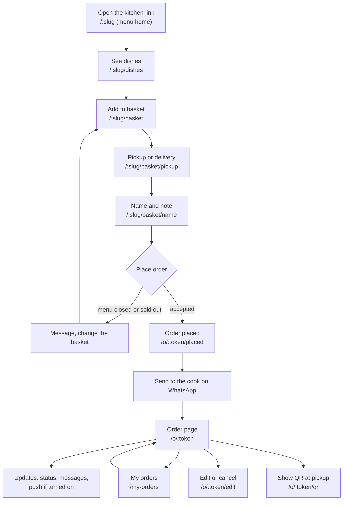
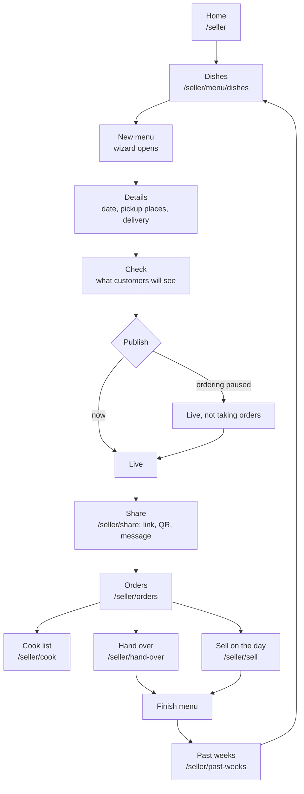
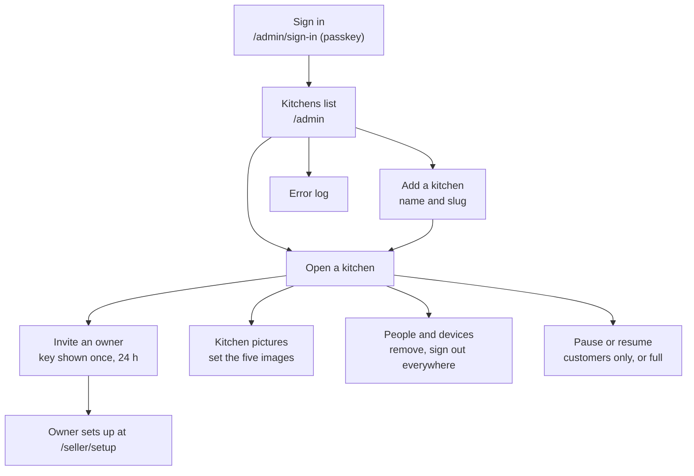

# Main UX flows

Written 2026-10-13 (plan 070) from the routes in `src/app/AppRoutes.tsx` and the screens in `src/features/`. The diagrams are Mermaid: GitHub draws them, and `pnpm run docs` draws them in the HTML site. When a main flow changes, change its diagram in the same change (CLAUDE.md, "Docs stay current"). What happens between the screens and the server is in [architecture/sequences.md](../architecture/sequences.md). The product in one page is [overview.md](overview.md).

## Customer: from the link to the updates

The customer opens the kitchen's link (`/:slug`), in English or Indonesian. There is no account and no payment. The order is confirmed on the **Order placed** page, where one button opens WhatsApp with the order already written; the customer sends it to the seller. The private link `/o/:token` is the way back to the order, and **My orders** (`/my-orders`) lists the orders this phone has placed.

## Seller: from dishes to a finished menu

The seller works in the app at `/seller`. A menu is made in a four-step wizard (**Dishes, Details, Check, Publish**), shown as a layer over the current screen. A live menu keeps three tabs (Dishes, Details, Prices) and has no Publish step. On the cooking day the seller packs, hands over and sells; **Finish** archives the orders and closes the menu, after which a new one can be made.

## Admin: kitchens and the first sign-in

The admin is the developer, a separate login (`/admin/sign-in`, first created at `/admin/setup`). The admin sees kitchens, people, devices, keys and the error log, and **never order data**. To open a kitchen, the admin adds it and invites its first owner, who then follows [invite and setup](../architecture/sequences.md#4-invite-then-setup-with-the-key).

