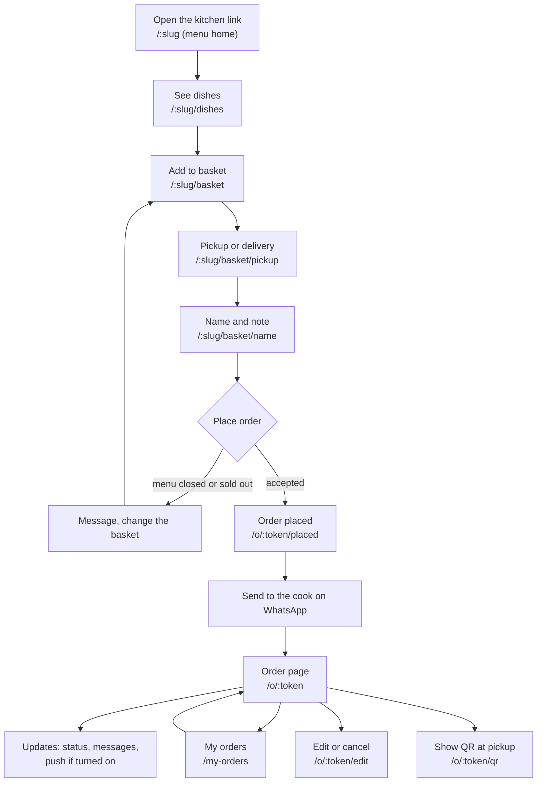
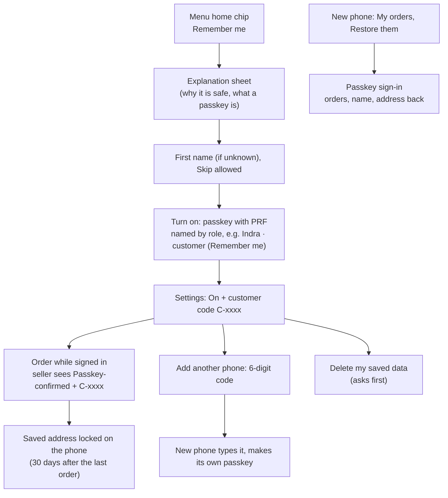
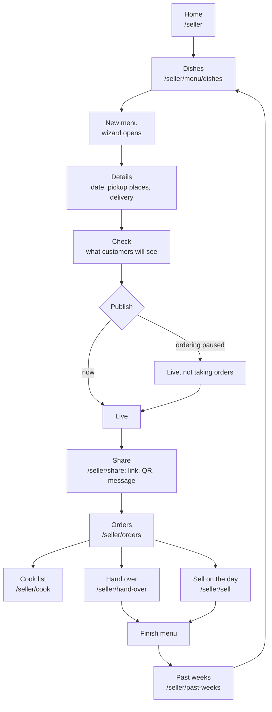
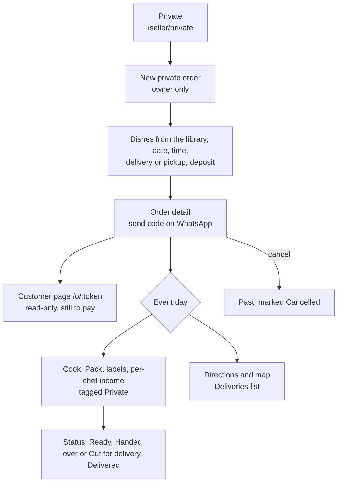
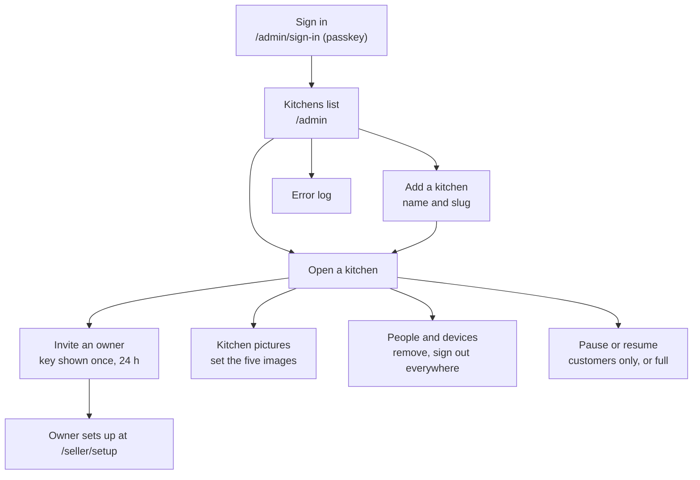

# Main UX flows

Written 2026-10-13 (plan 070) from the routes in `src/app/AppRoutes.tsx` and the screens in `src/features/`. The diagrams are Mermaid: GitHub draws them, and `pnpm run docs` draws them in the HTML site. When a main flow changes, change its diagram in the same change (CLAUDE.md, "Docs stay current"). What happens between the screens and the server is in [architecture/sequences.md](../architecture/sequences.md). The product in one page is [overview.md](overview.md).

## Customer: from the link to the updates

The customer opens the kitchen's link (`/:slug`), in English or Indonesian. There is no account and no payment. The order is confirmed on the **Order placed** page, where one button opens WhatsApp with the order already written; the customer sends it to the seller. The private link `/o/:token` is the way back to the order, and **My orders** (`/my-orders`) lists the orders this phone has placed.

### Customer: Remember me (optional, D-107)

- One shell banner (the kitchen's picture) sits on every customer page of a kitchen, with no small logo bar, so it no longer flashes when moving between pages. Bottom sheets lock the page behind them and close with a swipe down (or Close).
- Notice pills (one at a time, 40 px, ShaggyBobo icon): new version is green and the whole pill refreshes on tap; announcements and maintenance are amber. Home-screen and Remember me nudges use the same pill in a neutral colour.
- First visit: no nudges, only the menu. The name step has a quiet "Remember me on all my phones (?)" tick (the ? opens the explanation sheet; ticked, the turn-on runs after the order). After the first order a home-screen pill shows (browser only); the Remember me pill shows on the order-placed page only when it is off, 30 days after a dismiss, at most 3 times, then only the Settings card.
- The root page `/` is a standalone welcome page (About hero, logo, "Welcome to ShaggyBobo", a neutral hint to open the link you were sent): no tab bar, no jump in a browser; inside an installed app it jumps to the last kitchen. `noindex` and a neutral link preview.
- Everything is optional; ordering, links and My orders on one phone work without it. Offered by the chip (dismissable for good), the Settings card, one line after the second order and an empty My orders.
- A phone without the passkey PRF feature keeps the address on the phone only (a note says so). The passkey is named by role (customer, seller, admin); with no first name it falls back to "Remember me · ShaggyBobo's Order" (APP_NAME). Customer Settings shows Language, Appearance and Text size as value rows that open a choice sheet; bottom sheets slide up (not with Reduce Motion).
- "Delete my saved data" removes everything on our side at once; the phone keeps its own My orders; orders already placed are untouched.

## Seller: from dishes to a finished menu

The seller works in the app at `/seller`. A menu is made in a four-step wizard (**Dishes, Details, Check, Publish**), shown as a layer over the current screen. A live menu keeps three tabs (Dishes, Details, Prices) and has no Publish step. On the cooking day the seller packs, hands over and sells; **Finish** archives the orders and closes the menu, after which a new one can be made.

**Changing pickup or delivery (plan 083, D-105):** on an order's detail an owner or chef taps the quiet **Change** link next to the Pickup / Delivery line (menu and private orders; also after the cut-off). A sheet switches between a pickup place and a delivery address, with "Check on map" and a "Tell <name>" tick (on by default): ticked, the customer gets an inbox update and a push in their language; either way the order page shows the new way and Cook, Pack, labels and Pickup & delivery follow.

## Seller: a private order (Khusus)

A private order is a one-off order for an event (a birthday, a party) that only an owner makes, under **Private** in the left menu (phone: **More**). It is never on the menu and never touches its limits or cut-off. The owner picks library dishes, the event date and time, delivery or pickup and an optional deposit, then sends the order code on WhatsApp. The customer follows it on `/o/:token`, read-only, with what is still to pay. On the event day it is counted in Cook, Pack, labels and per-chef income with a "Private" tag; a cancelled one moves to Past.

## Admin: kitchens and the first sign-in

The admin is the developer, a separate login (`/admin/sign-in`, first created at `/admin/setup`). The admin sees kitchens, people, devices, keys and the error log, and **never order data**. To open a kitchen, the admin adds it and invites its first owner, who then follows [invite and setup](../architecture/sequences.md#4-invite-then-setup-with-the-key).

